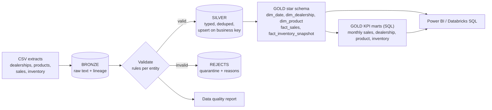

# Automotive MIS & KPI Analytics (PySpark, SQL, Delta Lake, Azure)

[](https://github.com/himanshuupadhyay300/automotive-mis-kpi-analytics/actions)


An end-to-end Management Information System (MIS) pipeline for an automotive business. It turns raw CSV extracts of
**sales, inventory, products and dealerships** into a **Delta Lake Bronze / Silver / Gold lakehouse**, a **star schema**
(facts and dimensions) and **SQL KPI marts** for sales trends, inventory movement, dealership performance and product KPIs,
ready for **Power BI**.


> **All data is synthetic** (fictional dealerships and vehicle models; amounts in INR). No company or customer data is used.

---

## Contents
1. [What this project demonstrates](#1-what-this-project-demonstrates)
2. [Honest status](#2-honest-status)
3. [Business problem](#3-business-problem)
4. [Architecture](#4-architecture)
5. [Technology stack](#5-technology-stack)
6. [Repository structure](#6-repository-structure)
7. [Data model and sample data](#7-data-model-and-sample-data)
8. [Quick start](#8-quick-start)
9. [Pipeline workflow](#9-pipeline-workflow)
10. [Incremental processing, duplicates and rerun safety](#10-incremental-processing-duplicates-and-rerun-safety)
11. [KPI SQL](#11-kpi-sql)
12. [Expected output and validation steps](#12-expected-output-and-validation-steps)
13. [Power BI integration and dashboard design](#13-power-bi-integration-and-dashboard-design)
14. [Testing and CI/CD](#14-testing-and-cicd)
15. [Azure deployment (optional)](#15-azure-deployment-optional)
16. [Security and secrets management](#16-security-and-secrets-management)
17. [Limitations and future enhancements](#17-limitations-and-future-enhancements)
18. [Publish on GitHub](#18-publish-on-github)

---

## 1. What this project demonstrates
- **Dimensional modelling**: a star schema with `dim_date` (Indian fiscal year), `dim_dealership`, `dim_product`, `fact_sales`, `fact_inventory_snapshot`, and deterministic surrogate keys.
- **SQL analytics**: four KPI marts written as plain SQL (window functions, ranking, ABC analysis, rolling averages, fiscal YTD) plus ten analysis queries.
- **Medallion lakehouse** with data quality rules, a quarantine table and a per-batch data quality report.
- **Correctness under messy data**: duplicates, late sales, corrections, orphan references, invalid values.
- **Independent validation**: expected counts, revenue and profit are computed by the data generator and compared to the Gold tables; an inventory reconciliation KPI cross-checks sales against stock.
- **Engineering discipline**: modular typed code, config separated from code, JSON logging, 89 tests, CI, no secrets in the repo.

## 2. Honest status

| Area | Status |
|---|---|
| Ingestion, Bronze/Silver/Gold, star schema, SQL marts (local, Parquet) | **Implemented and tested** (89 tests: 88 run by default plus 1 opt-in Delta test; full end-to-end run verified) |
| Data quality reports, incremental loads, rerun safety | **Implemented and tested** |
| Delta Lake path (`--format delta`) | Implemented, has a test and a non-blocking CI job. **Not executed in the environment this was built in** (Delta jars come from Maven). Run `make delta` to verify |
| Power BI | **Design, data model guidance, DAX and a wireframe only. No .pbix; DAX not validated in Power BI Desktop** |
| ADF pipeline, Databricks notebook, Synapse views, `deploy.sh`, Azure DevOps | **Templates. Nothing was deployed to Azure** |

No performance numbers are claimed. The sample has about 3,300 rows.

## 3. Business problem
A dealer network needs one trusted set of numbers: *How are sales trending? Which dealerships are hitting target? Which models
earn the margin? Is stock moving, and does inventory reconcile with sales?* Source extracts are unreliable: rows are duplicated,
sales arrive days late, figures get corrected, and reference data changes. This project builds the pipeline and the model that
make the answers repeatable and auditable.

## 4. Architecture



More diagrams (incremental-run sequence, star schema ER, local-vs-Azure map): [`architecture/architecture.md`](architecture/architecture.md).
Trade-offs and failure modes: [`docs/DESIGN_DECISIONS.md`](docs/DESIGN_DECISIONS.md).

## 5. Technology stack
Python 3.10+, PySpark 3.5, Spark SQL, Parquet (local) and Delta Lake (Azure), ADLS Gen2, Azure Databricks, Azure Data Factory,
Azure Synapse serverless SQL (optional), Power BI, pytest, ruff, GitHub Actions, Azure DevOps YAML.

## 6. Repository structure
```
automotive-mis-kpi-analytics/
├── README.md, Makefile, requirements*.txt, pyproject.toml, .env.example, .gitignore, LICENSE
├── config/pipeline_config.yaml        # paths, rules, thresholds (no secrets)
├── data/sample/                       # synthetic CSVs + expected/expected_counts.json
├── src/
│   ├── pipeline.py                    # CLI orchestrator
│   ├── ingestion/                     # bronze_ingest.py, generate_synthetic_data.py
│   ├── transformations/               # silver.py, gold_star.py, marts.py, dedupe.py
│   ├── validation/                    # entities.py (schemas + rules), quality_report.py
│   └── utils/                         # config, logging, spark session, storage, state, sql_runner
├── sql/
│   ├── marts/                         # 4 KPI mart SELECTs (file name = Gold table name)
│   ├── analysis_queries.sql           # 10 analytical queries
│   └── synapse_serverless_views.sql   # optional template
├── powerbi/                           # dax_measures.dax, dashboard_wireframe.svg
├── docs/                              # powerbi_integration.md, DESIGN_DECISIONS.md
├── architecture/architecture.md       # Mermaid diagrams
├── notebooks/                         # Databricks notebook (template)
├── pipelines/adf/                     # ADF pipeline, linked service, trigger (templates)
├── infrastructure/                    # deploy.sh, azure-pipelines.yml (templates)
├── tests/                             # 89 tests
└── .github/workflows/ci.yml
```

## 7. Data model and sample data

**Star schema** (grain: one sale; one dealership x product x weekly snapshot)

| Table | Type | Key columns / notes |
|---|---|---|
| `dim_date` | dimension | `date_key` yyyymmdd, calendar and **fiscal year (April-March)** attributes, 730 days |
| `dim_dealership` | dimension (SCD1) | `dealership_key`, region, city, `monthly_sales_target` |
| `dim_product` | dimension (SCD1) | `product_key`, model, variant, segment, fuel type, list price, unit cost |
| `fact_sales` | fact | quantity, gross / discount / net amount, cost, **gross profit**, `is_late_arrival`; partitioned by month |
| `fact_inventory_snapshot` | fact | units on hand and received per Sunday, stock value at cost; partitioned by month |

**Synthetic input files** (`data/sample/`)

| File | Content |
|---|---|
| `dealerships_001.csv`, `dealerships_002.csv` | 6 dealerships; file 002 raises one target by 10% (SCD1 update) |
| `products_001.csv` | 12 fictional vehicle variants (Hatchback, Sedan, SUV, MPV; Petrol, Diesel, CNG, Hybrid, EV) |
| `sales_batch_001.csv` | Jan-Apr 2025 sales plus defects |
| `sales_batch_002.csv` | May-Jun 2025 sales, 12 **late** April sales, 6 **corrections**, 4 cross-batch duplicates, defects |
| `inventory_batch_001/002.csv` | Weekly (Sunday) stock snapshots that reconcile exactly with sales |

Sample rows:
```csv
sale_id,sale_date,dealership_id,product_id,quantity,unit_price,discount_pct,payment_type,customer_type
S0000001,2025-01-01,D001,P002,1,640000,3.0,Loan,Retail
snapshot_date,dealership_id,product_id,units_on_hand,units_received
2025-01-05,D001,P001,8,0
```

Injected defects per batch (the generator records their expected effect): missing/invalid dates, negative quantities,
unknown dealerships/products, discounts of 150%, non-numeric prices, missing sale ids, exact duplicates, blank optional
fields, negative stock, an orphan inventory row.

## 8. Quick start
Requirements: Python 3.10+ and **Java 11, 17 or 21** (Spark needs a JVM). No Azure account. Built and tested locally on Python 3.12 with Java 21;
the CI matrix (3.11 and 3.12 with Java 17) is provided but has not run yet.

```bash
git clone https://github.com/<your-username>/automotive-mis-kpi-analytics.git
cd automotive-mis-kpi-analytics
python -m venv .venv && source .venv/bin/activate      # Windows: .venv\Scripts\activate
make install

make run      # batch 1, then batch 2 arrives (late sales, corrections, duplicates)
make sql      # 10 analytical queries
make test     # 89 tests
```

Without `make`:
```bash
python -m src.pipeline --only "*_001.csv"     # first delivery
python -m src.pipeline                        # only the new files are processed
python -m src.pipeline                        # nothing new: a no-op
python -m src.utils.sql_runner sql/analysis_queries.sql
```
Regenerate the data (deterministic): `make sample-data`. Reset: `make clean`. Delta Lake locally: `make delta`.
Outputs: tables in `output/lakehouse/`, reports in `output/reports/`.

## 9. Pipeline workflow
1. **Bronze** (`bronze_ingest.py`): find new files per entity (SHA-256 checksum), read as text, add lineage, append. Missing contract columns fail fast.
2. **Silver** (`silver.py`, rules in `entities.py`): references first, then sales and inventory. Type, validate (59 rules across the four entities, 23 of them for sales, including referential integrity), quarantine rejects, de-duplicate, flag late arrivals, upsert on the business key.
3. **Gold star** (`gold_star.py`): rebuild dimensions; rebuild only the fact months touched by new data (all months if product cost changed).
4. **Gold marts** (`marts.py` + `sql/marts/*.sql`): execute each KPI SQL file, write the result as a Gold table.
5. **State** (`state.py`): stage status per batch, so a crashed run resumes instead of losing data.

## 10. Incremental processing, duplicates and rerun safety
- **Files**: checksum-based; a renamed copy is skipped. A rerun with no new files changes nothing (asserted by a test).
- **Duplicates**: same `sale_id` and values collapse; the report separates exact duplicates from conflicting ones.
- **Corrections**: same `sale_id` with new values updates the sale; an older ingestion never overwrites a newer one.
- **Late data**: a new key older than that dealership's Silver maximum date is accepted, flagged `is_late_arrival`, and the affected months are recomputed.
- **Reference data**: SCD Type 1 merge (latest wins).
- **Gold**: partitions are *replaced*, never appended; marts are recomputed. Quarantine rows are replaced per batch.

## 11. KPI SQL
| Mart (`sql/marts/`) | Content |
|---|---|
| `mart_monthly_sales` | Units, net revenue, gross margin %, **month-over-month growth**, **fiscal YTD**, rolling 3-month average |
| `mart_dealership_monthly` | Revenue, margin, **target attainment %**, revenue **rank**, share of month |
| `mart_product_kpis` | Revenue, margin, discount, **ABC class**, cumulative share, inventory turnover for the period |
| `mart_inventory_weekly` | Opening, received, sold, closing, **reconciliation difference**, weeks of cover, stock-out flag |

`sql/analysis_queries.sql` adds region x segment mix, dealership leaderboard, target hit-rate, discounting vs margin by payment type,
thinnest stock cover, reconciliation exceptions, rejected rows by rule and late sales by month.

## 12. Expected output and validation steps
All figures below were produced by `make run` on the bundled data (seed 42) and are asserted by the integration test against
`data/sample/expected/expected_counts.json`, which the generator computes independently of the pipeline.

**After batch 1**
```
sales      : 878 rows read, 866 valid, 12 rejected (1.37%), 4 in-batch duplicates removed, 5 rows with warnings
             -> Silver 862 sales
             rejected by rule: missing_sale_date 3, out_of_range_quantity 2, orphan_dealership 2,
                               out_of_range_discount_pct 2, invalid_unit_price 1, invalid_sale_date 1, missing_sale_id 1
inventory  : 1230 rows read, 3 rejected, 3 duplicates removed -> Silver 1224 snapshots
Inventory reconciliation exceptions: 12   (exactly the 12 dealership/product/weeks missing the withheld late sales)
```
**After batch 2**
```
sales      : 473 rows read, 12 rejected, 12 late arrivals, 10 keys already present (6 of them corrections)
             -> Silver 1313 sales | inventory Silver 1872 snapshots | dealership D002 target 45.0M -> 49.5M
Quarantine : 24 sales + 4 inventory rows kept with their failed rule names
Gold       : fact_sales 1313 | fact_inventory_snapshot 1872 | monthly mart 6 rows | dealership-month mart 36
             product mart 12 | inventory weekly mart 1872
Totals     : net revenue INR 1,432,834,100 | gross profit INR 132,600,100 (9.25%) | units 1,453
             -> identical to the generator's independent calculation
Inventory reconciliation exceptions: 0
Re-run     : files_ingested=0, every table count unchanged
```

**Sample query results** (`make sql`; revenue in INR)

| year_month | units_sold | net_revenue | gross_margin_pct | mom_revenue_growth_pct | rolling_3m_avg_revenue |
|---|---|---|---|---|---|
| 2025-01 | 212 | 205,949,450 | 9.08 | | 205,949,450 |
| 2025-02 | 209 | 200,940,700 | 9.41 | -2.43 | 203,445,075 |
| 2025-03 | 298 | 286,363,150 | 9.22 | 42.51 | 231,084,433 |
| 2025-04 | 249 | 251,329,350 | 9.00 | -12.23 | 246,211,067 |
| 2025-05 | 260 | 261,509,550 | 9.52 | 4.05 | 266,400,683 |
| 2025-06 | 225 | 226,741,900 | 9.30 | -13.29 | 246,526,933 |

Latest month dealership leaderboard (target attainment uses the *current* targets):

| rank | dealership | region | net revenue | target attainment % |
|---|---|---|---|---|
| 1 | Sunrise Motors | West | 48,366,400 | 100.76 |
| 2 | Eastern Wheels | East | 39,474,900 | 109.65 |
| 3 | Garden City Motors | South | 38,184,250 | 76.37 |
| 4 | Capital Auto Hub | North | 37,162,850 | 75.08 |
| 5 | Lakeside Autos | Central | 33,901,750 | 89.22 |
| 6 | Coastline Cars | South | 29,651,750 | 70.60 |

Product ABC (revenue-based): 9 products are class A, 2 are B (Vega ZX, Vega LX) and 1 is C (Pulse E1).

**Validate it yourself**
1. `make clean && make run` finishes with `Pipeline success` twice.
2. Open `output/reports/dq_report_*.md`: batch 1 lists 12 rejected sales and 5 warnings; batch 2 lists 12 late arrivals.
3. `python -m src.utils.sql_runner sql/analysis_queries.sql`: Q8 (reconciliation exceptions) prints no rows.
4. Compare totals with `data/sample/expected/expected_counts.json` (`gold.total_net_revenue`).
5. `make test`: all tests pass.

## 13. Power BI integration and dashboard design
Full guide: [`docs/powerbi_integration.md`](docs/powerbi_integration.md). Contents: connector options (Databricks, Synapse serverless,
local Parquet), Import vs DirectQuery, the star-schema relationships, [`powerbi/dax_measures.dax`](powerbi/dax_measures.dax) (revenue,
margin, MoM, fiscal YTD, attainment, semi-additive stock measures, row-level security) and a three-page dashboard design.


*Wireframe populated with the real figures above. It is a design, not a Power BI export.*

## 14. Testing and CI/CD
```bash
make test                      # everything
pytest tests/test_marts.py     # KPI SQL verified on hand-computed star tables
RUN_DELTA_TESTS=1 pytest tests/test_delta.py
make lint
```
| Test file | What it proves |
|---|---|
| `test_rules.py` | each rule fires on a minimal bad record; missing vs invalid; optional fields only warn |
| `test_silver.py` | duplicates, corrections, imputation, SCD1, orphans, late flag, idempotent reprocessing |
| `test_gold_star.py` | fiscal calendar, surrogate keys, fact money columns incl. negative margin |
| `test_marts.py` | MoM growth, YTD, rolling average, rank, attainment, ABC, turnover, reconciliation |
| `test_bronze.py`, `test_storage.py`, `test_state.py`, `test_config.py` | ingestion contract, partition replace, state, config validation |
| `test_pipeline_integration.py` | batch 1 / batch 2 / re-run vs independent expectations; revenue and profit totals; star keys valid; keys unique |

**GitHub Actions** (`ci.yml`): lint, tests on Python 3.11 and 3.12, an end-to-end run that uploads the reports, plus a non-blocking Delta job.
**Azure DevOps** (`infrastructure/azure-pipelines.yml`, template): same test stage, then deploy with a service connection and an approval-gated environment.

## 15. Azure deployment (optional)
> Templates only; nothing was deployed. Review names, regions and cost first.

1. `infrastructure/deploy.sh`: resource group, ADLS Gen2 (hierarchical namespace), containers, Key Vault, Databricks, Data Factory, role assignment (Synapse step commented out).
2. Key Vault-backed Databricks secret scope; clone the repo into Repos.
3. `notebooks/01_run_mis_pipeline.py`: sets `format=delta` and an `abfss://` base path; use a Unity Catalog Volume for landing, state and report paths.
4. `pipelines/adf/`: linked service (token from Key Vault), pipeline, daily trigger. Ingestion is idempotent, so retries are safe.
5. Power BI: connect to Databricks SQL, or use `sql/synapse_serverless_views.sql` for Synapse serverless.
6. CI/CD with `ci.yml` or `azure-pipelines.yml`.

## 16. Security and secrets management
- No credentials in code or config; `.env.example` lists names only and `.env` is git-ignored.
- On Azure: managed identity or service principal, secrets in **Key Vault** surfaced through Databricks secret scopes; ADF reads its token from Key Vault.
- Private storage (public blob access off, TLS 1.2+), least-privilege role assignments, approval gates on deployments.
- Row-level security by region in Power BI (pattern provided). Synthetic data only.

## 17. Limitations and future enhancements
**Limitations**: SCD Type 1 (current target/cost applied to history); orphan sales are not auto-replayed when a missing reference arrives later;
the JSON state file is not safe for concurrent runs; the Parquet upsert is not atomic (Delta is); the Delta path is unverified here; no Power BI file.

**Future**: SCD Type 2 dimensions; replay job for quarantined rows; Delta control table for state; Auto Loader; a fail-the-run reject-rate gate;
incremental marts; a built and published Power BI report; Terraform/Bicep instead of the CLI script.

## 18. Publish on GitHub
```bash
git init && git add . && git commit -m "Automotive MIS and KPI analytics pipeline"
git branch -M main
git remote add origin https://github.com/<your-username>/automotive-mis-kpi-analytics.git
git push -u origin main
```
Replace `<your-username>`, add topics (`data-engineering`, `pyspark`, `delta-lake`, `star-schema`, `power-bi`, `azure`), and after the first
green CI run add a screenshot of the quality report.

---
**Author:** Himanshu Upadhyay · [LinkedIn](https://linkedin.com/in/hup2000) · MIT License
