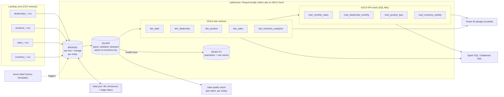
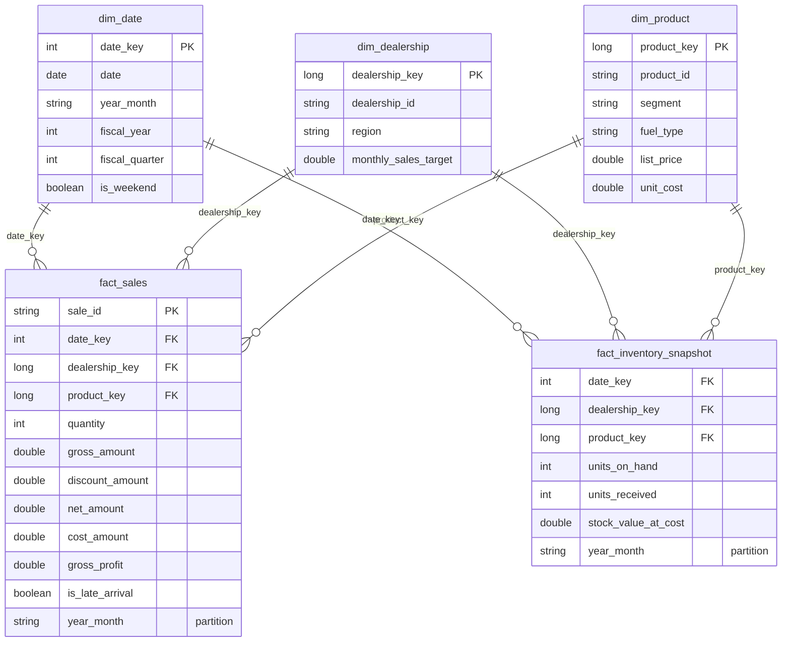

# Architecture

Mermaid diagrams render natively on GitHub.

## 1. End-to-end flow



## 2. Incremental run: late sales, corrections and duplicates

```mermaid
sequenceDiagram
    autonumber
    participant L as Landing zone
    participant P as Pipeline
    participant St as State store
    participant S as Silver
    participant G as Gold

    L->>P: new files (reference, sales, inventory)
    P->>St: checksum already ingested?
    St-->>P: skip known files, keep new ones
    P->>S: reference data first (dealerships, products) as SCD Type 1
    P->>S: sales: validate, check dealership/product exist, quarantine bad rows
    Note over P,S: de-duplicate in batch; compare with Silver:<br/>same key + same values = duplicate, same key + new values = correction,<br/>new key older than dealership watermark = late arrival
    P->>S: upsert on sale_id (latest ingestion wins)
    P->>G: rebuild dimensions, then ONLY the fact months touched
    P->>G: recompute KPI marts (small, full recompute)
    P->>St: mark batch complete
    Note over P,G: inventory reconciliation now shows whether any sales are still missing
```

## 3. Star schema



Grain: `fact_sales` = one sale; `fact_inventory_snapshot` = dealership x product x Sunday.

## 4. What runs where

| Component | Local (no Azure) | Azure |
|---|---|---|
| Bronze / Silver / Gold star / marts (PySpark + SQL) | Implemented and tested | Same code with `storage.format: delta` |
| Parquet storage | Implemented and tested | n/a |
| Delta Lake storage | Implemented, needs internet once for jars | Built into Databricks |
| Data quality reports | Implemented and tested | Same |
| Power BI | Design and DAX provided, no .pbix | Connect to Databricks SQL or Synapse serverless |
| ADF, Databricks notebook, Synapse views, `deploy.sh`, Azure DevOps | n/a | Templates, not deployed |
| GitHub Actions CI | Workflow provided | n/a |
