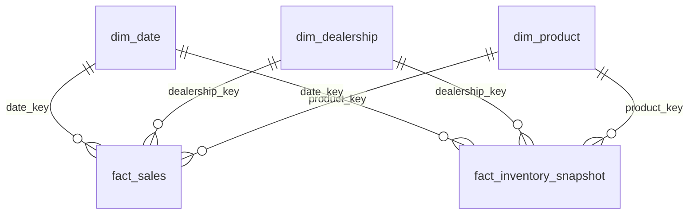

# Power BI integration guide and sample dashboard design

> **Status:** guidance and a design. **No Power BI report (.pbix) is included** and the DAX was not validated in
> Power BI Desktop. The wireframe uses real values from the bundled synthetic sample.

## 1. Connecting to the data

| Where the Gold tables live | Connector | Notes |
|---|---|---|
| Azure Databricks (Delta, recommended) | *Azure Databricks* connector (or Databricks SQL warehouse) | Register tables with `sql/databricks_create_tables.sql`; use a service principal, not a personal token |
| Synapse serverless SQL | *Azure Synapse Analytics SQL* connector | Views over Delta in `sql/synapse_serverless_views.sql` (template) |
| Local Parquet (try-it-out) | *Parquet* connector, or load CSV exports | Point it at `output/lakehouse/gold/<table>` |

**Import vs DirectQuery.** The Gold layer is small and refreshed daily, so **Import** mode is the default: fast
visuals and no warehouse cost per click. Use DirectQuery or composite models only when data must be near real time.

## 2. Data model

Load the five star tables plus the four marts.

- All relationships are one-to-many, single direction, from dimension to fact. Mark `dim_date[date]` as the Date table.
- The `mart_*` tables are pre-aggregated and stand alone. Relate `mart_dealership_monthly` to `dim_dealership` on `dealership_id`
  if you want slicers to filter it.
- Hide surrogate key columns from report view; expose business names.
- Inventory is a **snapshot** fact: never sum `units_on_hand` across weeks. Use the *Closing Units* measure in `powerbi/dax_measures.dax`.

## 3. Measures
See [`powerbi/dax_measures.dax`](../powerbi/dax_measures.dax): revenue, profit, margin, discount, MoM growth, fiscal YTD
(April to March), target attainment, closing stock, reconciliation exceptions, late-arriving sales, and a row-level-security pattern.

## 4. Dashboard design (3 pages)

**Page 1 - Executive overview** (wireframe above)
- Slicers: fiscal year, region, segment, month
- KPI cards: net revenue, units, gross margin, transactions
- Monthly net revenue column chart with a rolling 3-month average line (`mart_monthly_sales`)
- Dealership ranking bar chart, colour-coded by target attainment (`mart_dealership_monthly`)

**Page 2 - Dealership and product performance**
- Matrix: region > dealership by revenue, margin %, attainment %, revenue rank
- Product ABC: Pareto chart of revenue with the cumulative share line, coloured by `abc_class` (`mart_product_kpis`)
- Scatter: average discount % (x) vs gross margin % (y), bubble size = units, to spot discount-driven margin loss
- Segment and fuel-type revenue mix (EV share over time)

**Page 3 - Inventory and data trust**
- Weeks-of-cover heat map: dealership x model, latest week (`mart_inventory_weekly`)
- Stock value trend at cost
- *Data trust* panel: reconciliation exceptions (should be 0), late-arriving sales, rejected rows by rule (from the data quality report)

**Design rules:** one message per visual; fixed colour meaning (green on or above target, amber 85-99%, red below 85%);
INR formatting in crore for headline numbers; tooltips show margin and discount; every page has the same slicer bar.

## 5. Refresh, security and governance
- Schedule dataset refresh after the ADF/Databricks run (for example the pipeline at 06:00 UTC, refresh at 07:00 UTC).
- Row-level security by region (pattern in the DAX file); keep the mapping table in a governed source.
- Authenticate with a service principal or managed identity; store no credentials in the .pbix.
- Show a "data as of" card from `MAX(fact_sales[sale_date])` so users see how fresh the numbers are.
